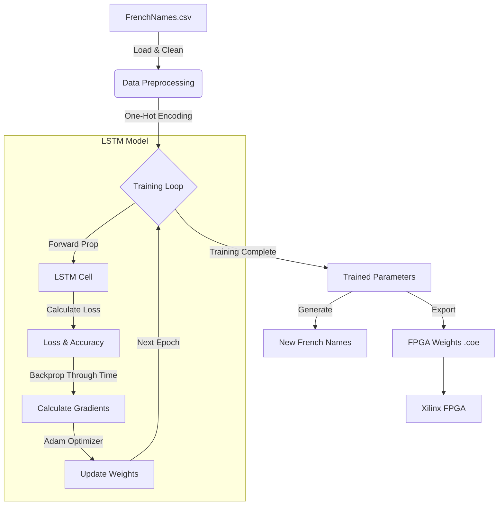

# LSTM from Scratch with FPGA Export


## Project Overview

This repository contains a complete implementation of a **Long Short-Term Memory (LSTM)** neural network built from scratch using **Python** and **NumPy**. Unlike standard implementations that rely on high-level frameworks like TensorFlow or PyTorch, this project manually implements the forward and backward propagation algorithms, as well as the Adam optimizer.

The model is designed to perform character-level text generation, trained on a dataset of French names. A key feature of this project is its ability to export the trained weights into **.coe (Coefficient)** files, which are compatible with Xilinx FPGAs, enabling hardware-based inference.

## Architecture

The following diagram illustrates the high-level architecture and data flow of the project:



## Features

- **Pure NumPy Implementation**: No deep learning frameworks used; great for understanding the math behind RNNs.
- **Custom LSTM Cell**: Manual implementation of Forget, Input, Output, and Candidate gates.
- **Adam Optimization**: Custom implementation of the Adam optimization algorithm.
- **FPGA Integration**: Exports weights to `.coe` format for initialization of Block RAMs in Xilinx FPGAs.
- **Visualization**: Real-time plotting of Loss, Perplexity, and Accuracy during training.

## Installation

To run this project, you need Python installed along with the following dependencies:

```bash
pip install numpy pandas matplotlib
```

## Usage

1.  **Clone the repository:**
    ```bash
    git clone https://github.com/yourusername/long-short-term-memory.git
    cd long-short-term-memory
    ```

2.  **Run the training script:**
    ```bash
    python LSTM.py
    ```
    This will start the training process, outputting metrics to the console and generating plots for Loss, Perplexity, and Accuracy.

3.  **Export Weights:**
    The script automatically generates `.coe` files in the `output/` directory (or root, depending on configuration) which can be used for FPGA synthesis.

## Contributing

Contributions are welcome! If you find a bug or want to improve the implementation (e.g., add more layers, optimize the backward pass), please feel free to open an issue or submit a pull request.

1.  Fork the Project
2.  Create your Feature Branch (`git checkout -b feature/AmazingFeature`)
3.  Commit your Changes (`git commit -m 'Add some AmazingFeature'`)
4.  Push to the Branch (`git push origin feature/AmazingFeature`)
5.  Open a Pull Request

## License

Distributed under the MIT License. See `LICENSE` for more information.
